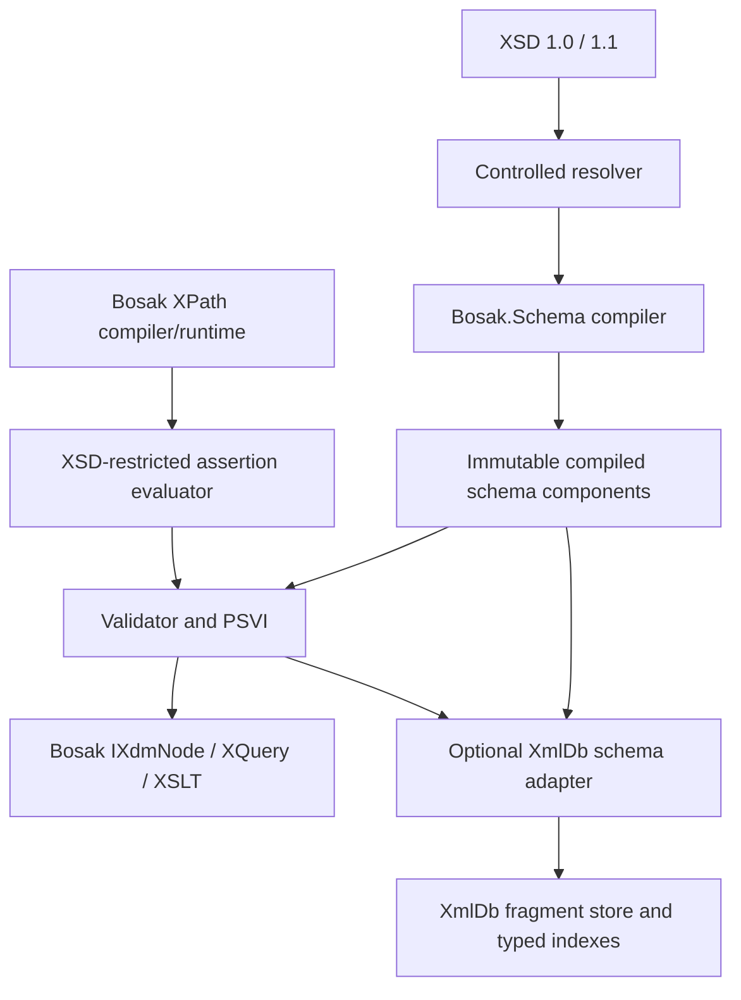
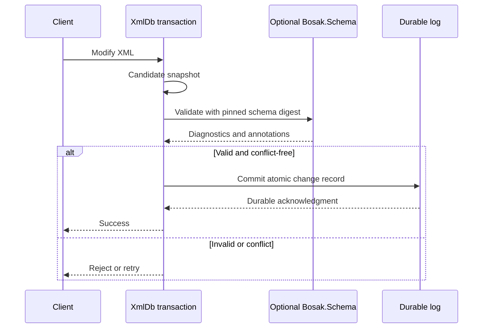
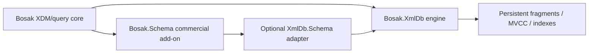

# Bosak.Schema — XSD 1.1 Technical Design and Agent Handover

> **Transferred 2026-10-30** from the private Bosak.Licensing repository as REQ-009 decision evidence. This document predates the Apache-2.0 public split of 29 October 2026: its "commercial add-on", license-gate and activation framing is historical context, not current behavior — public schema services are activation-free. See [AGENT_HANDOVER](AGENT_HANDOVER.md).

**Version:** 0.1 · **Date:** 2026-10-27 · **Status:** Proposed, not implemented · **Target:** .NET 10

## Mission

Extend the existing **Bosak.Schema** commercial add-on to support W3C XML Schema 1.1 in stages, while preserving the Bosak core/plugin boundary and enabling optional schema-aware functionality in Bosak.XmlDb. Do **not** create a competing `Bosak.XmlSchema` library or claim full XSD 1.1 conformance after implementing only a subset.

**Agent: start with a source audit (S0), then implement only an approved first vertical slice.** Follow the repository's `AGENTS.md` and documentation conventions; those instructions take precedence over proposed file names here.

## Verified repository inventory

Reviewed the user-supplied `Bosak.Schema-main.zip`:

| File | Existing role |
|---|---|
| `src/Bosak.Schema/SchemaAwareXslt.cs` | License-gated creation of schema-aware `XsltCompiler`; schema resolution configuration |
| `src/Bosak.Schema/License.cs` | Commercial activation boundary; do not alter for this work |
| `tests/Bosak.Schema.Tests/ComplexTypeValidationTests.cs` | Existing validation regression tests |
| `tests/Bosak.Schema.Tests/ImportSchemaSliceTests.cs` | `xsl:import-schema` regression tests |
| `docs/SEAM_DESIGN.md` | H1–H4 public integration seams |
| `docs/ADR-001-h3-typed-construction-api.md` | Typed construction/annotation design |
| `docs/ADR-002-h4-validation-service.md` | Validation service, strict/lax/strip/preserve semantics |
| `docs/ARCHITECTURE.md` | Package boundaries and dependency policy |
| `AGENTS.md`, `Bosak.Schema.slnx`, `global.json` | Coding rules, build/test commands, SDK |

**Critical observation:** The present Bosak.Schema assembly is small and uses existing Bosak/.NET schema capabilities; it is not an independent complete XSD 1.1 compiler. The architecture docs describe the add-on as referencing **published** Bosak packages rather than copying or directly linking the core source. Verify exact package/API versions before coding.

## Non-negotiable boundaries

- Bosak core must never reference Bosak.Schema. The add-on references Bosak's published public APIs.
- Bosak.XmlDb must work untyped and embedded **without** the commercial add-on; a separate optional adapter may reference both projects.
- Keep licensing, key material, activation and expiry semantics unchanged.
- Preserve current XSD 1.0, XQuery, XSLT and PSVI behavior and error codes.
- Secure external schema resolution: default deny network/DTD/external entities; enforce import limits and allowlists.
- Do not change public Bosak APIs without a separate compatibility ADR and approval.

## Architecture



### Proposed internal layout

Keep a single distributable `Bosak.Schema` assembly initially:

```text
src/Bosak.Schema/
  Compilation/SchemaCompiler.cs
  Compilation/SchemaComponentRegistry.cs
  Model/CompiledSchema.cs
  Model/AssertionDefinition.cs
  Model/TypeAlternativeDefinition.cs
  Validation/SchemaValidator.cs
  Validation/AssertionValidator.cs
  XPath/AssertionStaticContext.cs
  XPath/CompiledAssertion.cs
  Psvi/SchemaAnnotationBridge.cs
  Integration/SchemaServiceAdapter.cs
  SchemaAwareXslt.cs                 # existing; preserve
  License.cs                         # existing; preserve

tests/Bosak.Schema.Tests/Xsd11/
  AssertionTests.cs
  CompatibilityTests.cs
  SecurityTests.cs
  SchemaComponentTests.cs
```

All paths except the two noted existing files are **proposals**; adjust to repository conventions.

## Proposed C# contracts

These are design sketches, **not existing Bosak APIs**. Define supporting types and adapt to actual public Bosak signatures after the audit.

```csharp
public enum XsdLanguageVersion { Xsd10, Xsd11 }

public interface ISchemaResourceResolver
{
    Stream Open(Uri resolvedUri);
}

public sealed record SchemaCompileOptions(
    XsdLanguageVersion Version,
    ISchemaResourceResolver Resolver);

public interface ICompiledSchema
{
    string SchemaId { get; }
    string Sha256Digest { get; }
    XsdLanguageVersion LanguageVersion { get; }
}

public interface IXsdSchemaCompiler
{
    ICompiledSchema Compile(
        XmlReader reader,
        Uri baseUri,
        SchemaCompileOptions options);
}

public sealed record SchemaDiagnostic(
    string Code, string Message, string? NodePath);

public sealed record SchemaValidationResult(
    bool IsValid,
    IReadOnlyList<SchemaDiagnostic> Diagnostics);

public interface IXsdValidationService
{
    SchemaValidationResult Validate(
        IXdmNode document,
        ICompiledSchema schema);
}

public interface ICompiledAssertion
{
    bool Evaluate(IXdmNode contextNode);
}

public interface IXsdAssertionCompiler
{
    ICompiledAssertion Compile(
        string expression,
        AssertionStaticContext context);
}
```

**Design warning:** PSVI requires an explicit annotation lifetime strategy: an immutable annotated XDM view or snapshot-scoped annotation side table, not silent mutation of shared persistent nodes. The `Validate` result above is insufficient by itself for complete PSVI; specify a richer result when implementing it.

**Assertion semantics:** XSD 1.1 `xs:assert` and `xs:assertion` have distinct contexts. The W3C specification constrains the XPath environment, static context, functions, type handling and error behavior. Reusing an unrestricted XPath 3.1 evaluator without a compatibility layer is not conformant. Cache compiled assertions by schema digest and static context.

## First vertical slice: `xs:assert`

Illustrative schema (not an OAGIS schema):

```xml
<xs:schema xmlns:xs="http://www.w3.org/2001/XMLSchema"
           version="1.1" elementFormDefault="qualified">
  <xs:element name="OrderLine">
    <xs:complexType>
      <xs:sequence>
        <xs:element name="OrderedQuantity" type="xs:decimal"/>
        <xs:element name="ShippedQuantity" type="xs:decimal"/>
      </xs:sequence>
      <xs:assert test="ShippedQuantity le OrderedQuantity"/>
    </xs:complexType>
  </xs:element>
</xs:schema>
```

Valid: `<OrderLine><OrderedQuantity>10</OrderedQuantity><ShippedQuantity>7</ShippedQuantity></OrderLine>`.

Invalid: `<OrderLine><OrderedQuantity>10</OrderedQuantity><ShippedQuantity>12</ShippedQuantity></OrderLine>`.

Acceptance tests must cover positive/negative cases, namespaces, decimal values, invalid XPath, multiple assertions, errors, XSD 1.0 rejection of 1.1-only constructs, and baseline regression. Never infer full conformance from this example.

## XmlDb transaction integration



- Validate the **final candidate** document at a stable transaction snapshot, and coordinate with conflict checks.
- Persist schema ID, digest, version and validation policy in document metadata and commit records.
- Replicas must replay with pinned schema interpretation; do not silently revalidate under a different version.
- Initially use whole-document or conservative subtree validation. Dependency-based incremental validation is a later optimization, not a correctness shortcut.
- XmlDb's optional schema adapter can provide type/cardinality metadata for fragment layout and typed indexes; an XSD alone does not encode access frequency or workload-specific fragmentation policy.



The arrows above indicate runtime integration/capability use, **not** a compile-time dependency from Bosak core or base XmlDb to Bosak.Schema.

## Milestone sequence

| Phase | Scope | Acceptance evidence |
|---|---|---|
| **S0** | Source/API audit, current schema feature matrix, test baseline | `docs/XSD11_SOURCE_AUDIT.md`, `docs/XSD11_GAP_MATRIX.md` |
| **S1** | Immutable compiled schema model and safe resolver | XSD 1.0/1.1 fixture parsing, stable digest, compatibility tests |
| **S2** | `xs:assert` with restricted XPath context | Positive/negative and error tests |
| **S3** | Simple-type `xs:assertion` facets | Typed value and facet conformance subset |
| **S4** | `xs:alternative` conditional type assignment | Conditional typing and PSVI tests |
| **S5** | Remaining XSD 1.1 constructs, identity constraints, open content, datatypes | Explicit W3C conformance coverage matrix |
| **S6** | Optional XmlDb schema adapter | Typed-index and transaction-validation integration tests |
| **S7** | Caching and incremental validation | Benchmarks plus correctness-preserving fallback |

**Scope gate:** Complete S0 first. Implement S1/S2 only when the exact public seams and the assertion context are documented. Request approval before public Bosak API changes.

## Agent execution checklist

1. Read `AGENTS.md`, `docs/ARCHITECTURE.md`, `docs/SEAM_DESIGN.md`, ADR-001 and ADR-002, and the current `ROADMAP.md`.
2. Inspect `global.json`, then run `dotnet build Bosak.Schema.slnx` and `dotnet test Bosak.Schema.slnx`. Record SDK, commit, pass/fail counts and blockers; never fabricate results.
3. Trace existing schema compilation/validation from `SchemaAwareXslt` through Bosak published APIs. Audit `IXdmNode`, `EvaluationContext`, `XdmSchemaAnnotator`, `XsdValidator`, `XsltCompiler`, and the XPath compiler. Record exact methods, packages and versions.
4. Produce `docs/XSD11_SOURCE_AUDIT.md` with source locations and `docs/XSD11_GAP_MATRIX.md` with each XSD 1.1 feature, existing support, missing work and test references.
5. Write an ADR covering compiled schema model, XSD-specific XPath context, PSVI storage, resolver security and optional XmlDb integration.
6. Implement the smallest `xs:assert` slice behind an explicit XSD 1.1 mode, without changing existing behavior.
7. Add regression, conformance, security and concurrency tests. Run the full suite; report unsupported cases explicitly.
8. Produce a completion report containing changed files, commands/results, benchmark measurements (if any), risks, limitations and next milestone proposal.

## Verification and release criteria

- Existing Bosak.Schema tests remain green, including `ComplexTypeValidationTests`, `ImportSchemaSliceTests`, licensing and activation tests.
- XSD 1.0 behavior is unchanged; unsupported XSD 1.1 constructs produce explicit diagnostics rather than silent acceptance.
- Schema resolution has bounded, testable security controls.
- Compiled schema/assertion objects are immutable or their thread-safety constraints are documented.
- XSD 1.1 conformance claims cite exact W3C test IDs and excluded features; differential tests against a conforming validator are recommended where permitted.
- No secrets, signing keys, credentials or production configuration are committed.
- No mandatory Bosak.Schema dependency is introduced into Bosak or Bosak.XmlDb.

## Handover completion template

```markdown
### Implementation report
- Repository commit / SDK / package versions:
- Phase completed (S0, S1, S2):
- Source files inspected:
- Files added/modified:
- Tests and commands executed (pass/fail/blocked):
- W3C conformance cases verified:
- Performance results and test conditions:
- Public API changes and ADRs:
- Unsupported constructs / known limitations:
- Risks and next recommended task:
```

## Reference material

- Local repo: `docs/SEAM_DESIGN.md`, `docs/ARCHITECTURE.md`, `docs/ADR-001-h3-typed-construction-api.md`, `docs/ADR-002-h4-validation-service.md`, `AGENTS.md`.
- W3C XML Schema 1.1 Part 1 (Structures): https://www.w3.org/TR/xmlschema11-1/
- W3C XML Schema 1.1 Part 2 (Datatypes): https://www.w3.org/TR/xmlschema11-2/
- W3C XPath 2.0: https://www.w3.org/TR/xpath20/

**Status note:** This is an implementation handover and proposed design. No XSD 1.1 code was added or tested in preparing this document.
